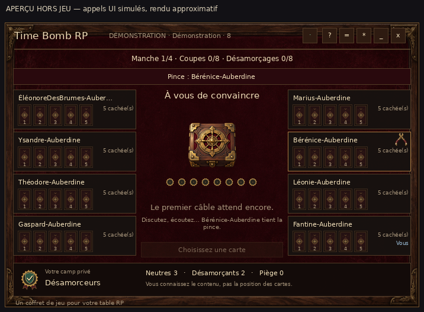
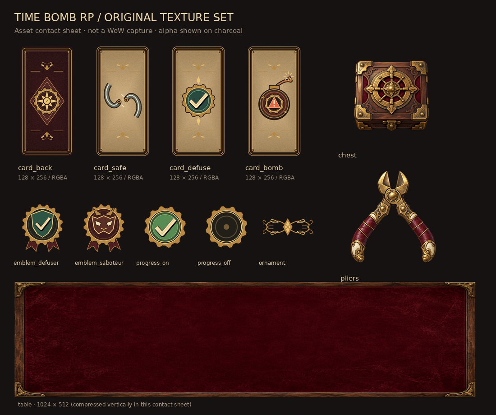

# Time Bomb RP · 1.0.0

Un addon **World of Warcraft Retail** autonome pour jouer à Time Bomb classique en RP, à **4–8 personnes**, avec une variante obligatoire : **aucun retour immédiat de la pince**.

L'addon gère les secrets, les cartes et l'arbitrage. Les personnages gardent leurs discussions, leurs mensonges et leur rythme. Le coffret est un jeu posé sur une table de taverne ; aucun chronomètre ni véritable bombe dans la scène.

## Installer

1. Télécharger [`dist/TimeBombRP-1.0.0.zip`](dist/TimeBombRP-1.0.0.zip).
2. Extraire dans `_retail_/Interface/AddOns/`. Le fichier doit se trouver exactement dans `Interface/AddOns/TimeBombRP/TimeBombRP.toc`.
3. Installer la même version chez chaque participant, puis relancer le client ou faire `/reload`.
4. Ouvrir avec `/timebomb` ou `/tb`.

Aucune dépendance d'exécution externe, aucune compilation d'images, aucun compte ni serveur compagnon. Aucun prérequis RoseEtCrane, Ace3 ou TRP3.

**Cible vérifiée dans les sources : Retail 12.1.5 (70340), interface 120105.** Le client installé chez vous n'a pas été inspecté. Voir [les signatures, enums et restrictions vérifiés](docs/API-TARGET.md).

## Jouer

Créer une table → inviter par nom ou cible → accepter → tous cliquer Prêt → l'hôte distribue → discuter → sélectionner une carte adverse → confirmer la coupe → transmettre la pince → redistribuer après la manche → résultat → revanche ou départ.

La fenêtre déployée mesure 700×480 ; la barre locale réduite 330×40. Les réglages `*` donnent accès aux sons, au mouvement réduit, à l'échelle, aux invitations ignorées, à l'annulation et au départ confirmé. `?` affiche les règles ; `=` ouvre les faits publics. Fermer ou réduire conserve votre place et laisse les messages arriver.

Le rôle et les comptes privés sont séparés des cartes. **Votre client ne reçoit pas la position des faces cachées, même de vos propres cartes.** L'hôte voit la même projection dans son interface, mais son processus détient nécessairement l'état autoritaire complet. Un hôte modifié peut tricher ; pas de protection contre collusion ou captures d'écran.

A coupe chez B : B ne peut pas choisir A. B coupe chez C : C peut choisir A, mais pas B. Cette interdiction persiste entre les manches et après `/reload`. Elle ne peut pas être désactivée.

| Commande | Action |
|---|---|
| `/tb`, `/timebomb` | Ouvrir ou masquer la fenêtre |
| `/tb invite Nom-Royaume` | Inviter à la table dont vous êtes l'hôte |
| `/tb leave` | Afficher la confirmation de départ |
| `/tb resetui` | Réinitialiser la position et l'échelle |
| `/tb demo` | Démonstration isolée à quatre joueurs |
| `/tb demo 8` | Démonstration isolée à huit joueurs |

La démonstration utilise le vrai moteur, la même interface et des clients simulés séparés. Dans les options, « Jouer un coup de démo » et « Changer de point de vue » permettent de la parcourir. Elle n'émet aucun message réseau réel et ne remplace pas la récupération d'une table live.

## Communication et récupération

Invitations et états passent par des **messages addon privés ciblés**, sans invitation de groupe WoW. Le premier scénario à valider est quatre personnages **non groupés, même royaume, même faction**. Le routage entre royaumes ou factions n'est pas garanti.

**Les restrictions Retail de royaume et de messagerie peuvent interdire ces envois.** L'addon affiche alors l'indisponibilité et respecte le blocage ; il ne cherche pas à le contourner. Le débit conservateur peut rendre la distribution initiale sensible : la simulation à huit clients mesure environ 35 secondes avant que tous puissent jouer. Un envoi local réussi ne prouve pas une réception. « Sans réponse » ne signifie pas « addon absent ».

Une absence suspend la partie après un délai de grâce. L'hôte peut attendre ou annuler ; aucun choix automatique, défaite ou migration d'hôte. Un départ volontaire pendant une partie l'annule.

Un `/reload` ordonné enregistre un checkpoint par personnage, distinct des options, et restaure le siège existant. La reprise de l'hôte attend la comparaison avec les révisions des participants. Un checkpoint plus ancien qu'une coupe déjà acceptée provoque une suspension, jamais un retour silencieux en arrière. Les SavedVariables de l'hôte contiennent les secrets nécessaires : ne les publier dans aucun rapport de bug. Une panne brutale n'offre pas de garantie d'écriture disque. Les checkpoints expirent après 12 heures. Une reprise incohérente est mise à l'écart ; l'hôte peut fermer proprement la table sans reconstruire les secrets corrompus.

## Vérifier et construire

Python 3.12+ recommandé. Les bibliothèques Python servent exclusivement aux tests et aux outils hors jeu.

```sh
python -m pip install -r requirements-dev.txt
python tools/test.py
python tools/check.py
python tools/assets_build.py --verify
python tools/build.py
```

- Tests sur un **vrai interpréteur Lua 5.1** via Lupa : règles, projections, réseaux simulés, reprises et intégration UI.
- Parcours générés et exploration exhaustive des nombres de cartes restantes pour la variante anti-retour.
- Simulation avec clients séparés, retards, pertes, doublons, réordonnancement et transport réellement fragmenté/limité en débit.
- Double d'API pour les signatures d'appel, parcours UI, absence de croissance des frames et démarrage de l'adaptateur Retail.
- Contrôle du TOC, des textures RGBA/POT et du ZIP. CI GitHub Actions incluse.

**Les doubles d'API et simulations ne sont pas des essais dans WoW.** Le rendu natif, les invitations non groupées et la recette à quatre vrais clients restent à effectuer suivant [la checklist](docs/IN-GAME-CHECKLIST.md). Le bilan des commandes effectivement exécutées est dans [VALIDATION.md](docs/VALIDATION.md).

## Aperçus hors jeu



Cet aperçu est produit à partir des appels de l'interface avec un double d'API et des métriques de texte approximatives. **Ce n'est pas une capture de WoW.**



Les textures finales, leurs sources, prompts et empreintes figurent dans [Assets](TimeBombRP/Assets/README.md). Les images peintes sont générées ; les cartes et symboles exacts sont construits par script. Aucun asset commercial de Time Bomb n'est inclus.

## Documentation

- [Règles, thème et variante maison](RULES.md)
- [Architecture et protocole](docs/ARCHITECTURE.md)
- [Cible Retail et restrictions](docs/API-TARGET.md)
- [Checklist native](docs/IN-GAME-CHECKLIST.md)
- [Validation et limites](docs/VALIDATION.md)

Code et éléments originaux sous [licence MIT](LICENSE). Adaptation non officielle du jeu de Yusuke Sato édité par IELLO, sans affiliation ni approbation de ses ayants droit.
